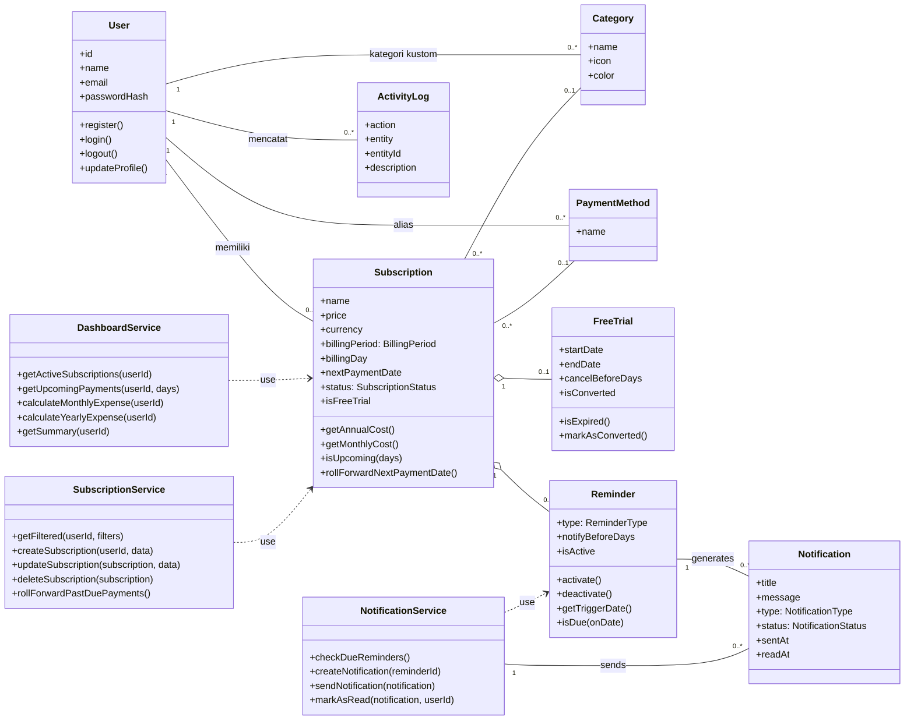
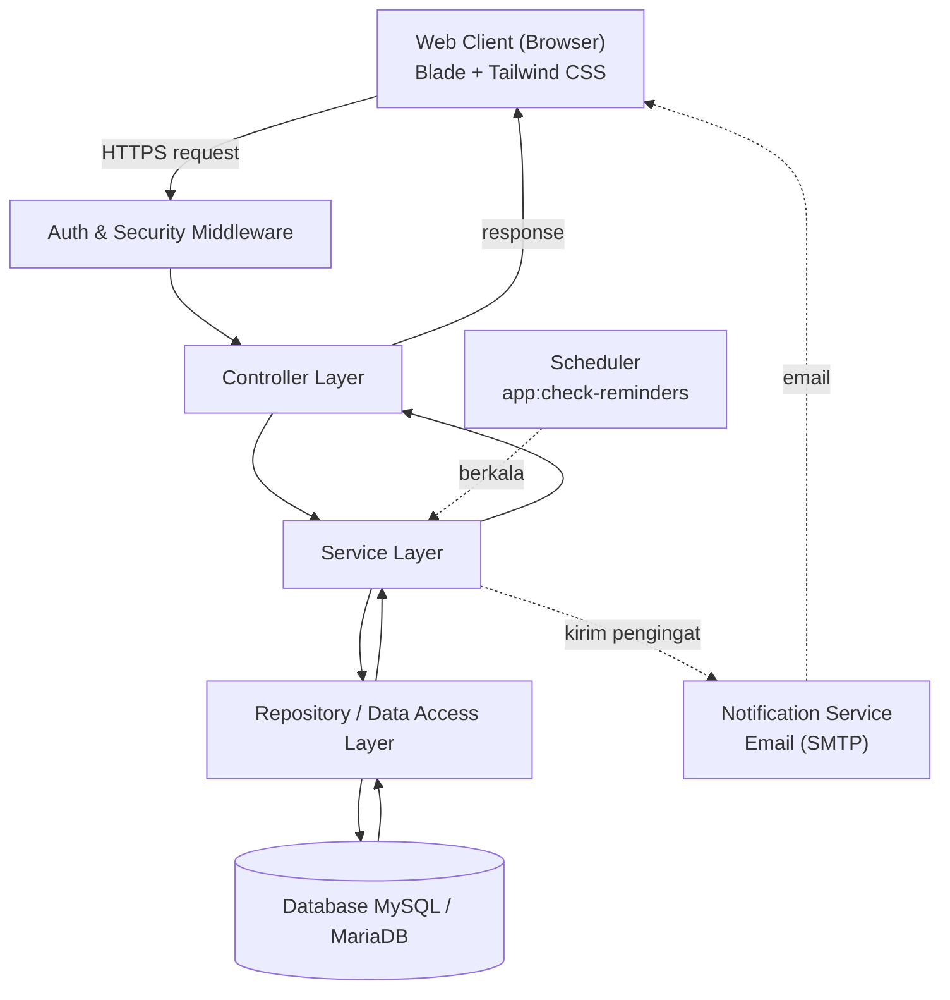
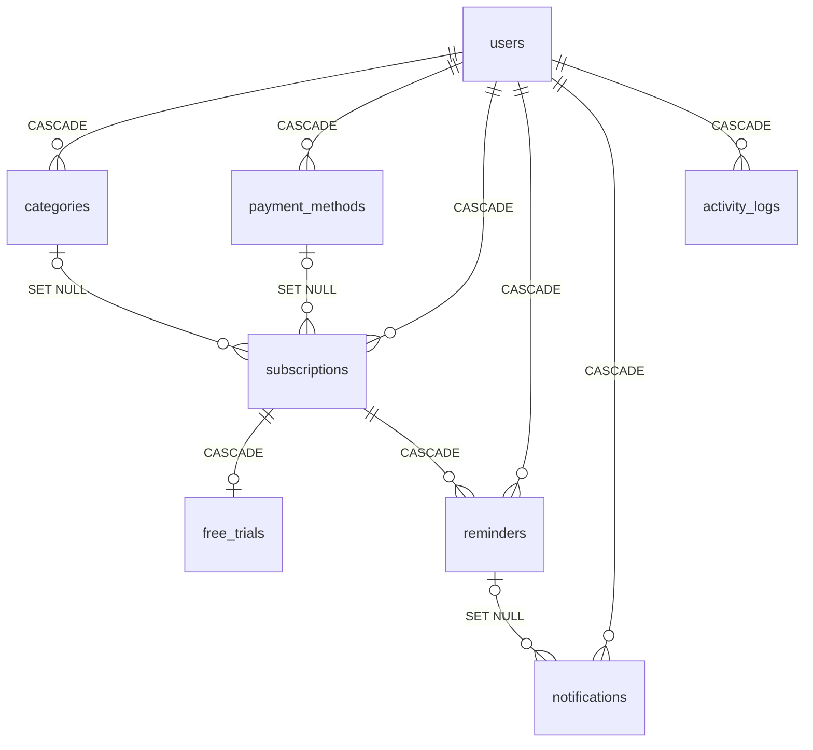
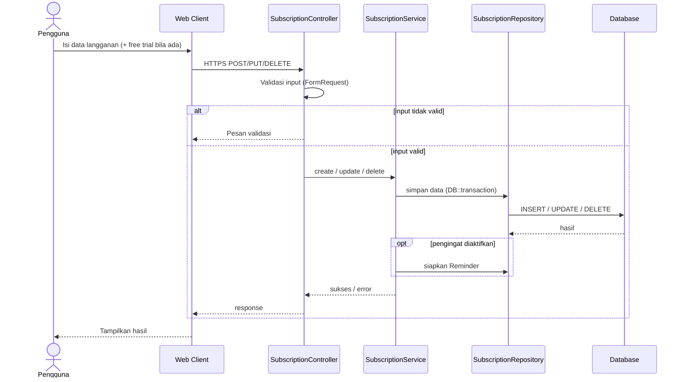
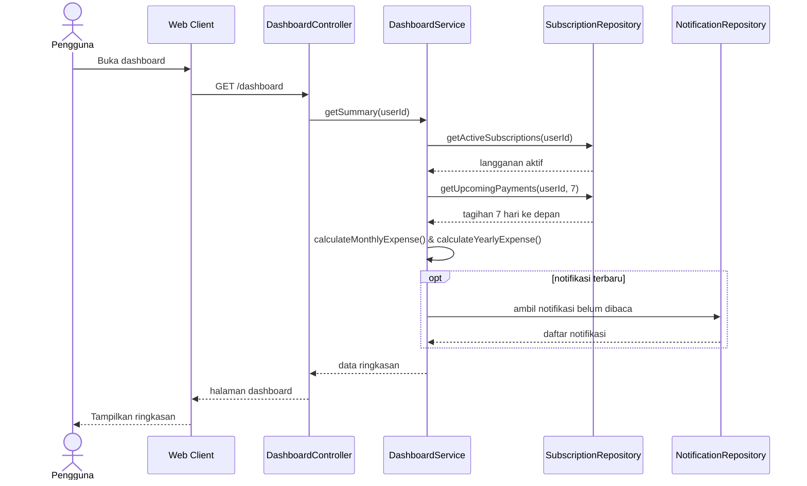
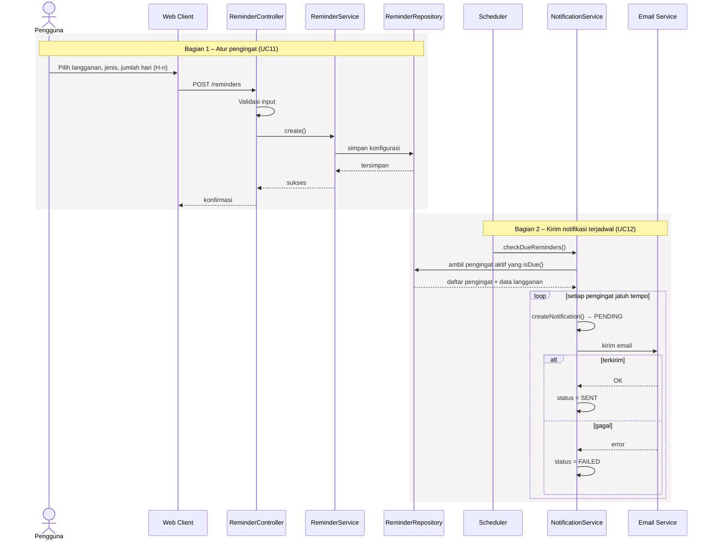

# DOKUMEN DESAIN SISTEM (SYSTEM DESIGN)

**Mata Kuliah:** Software Engineering | **Dosen Pengampu:** Christian, S.Kom., M.MT.  
**Program Studi:** Informatika, Universitas Ciputra Surabaya (2026)  
**Aplikasi:** Subscription Tracker (Team 5)  
**Anggota Kelompok:** Arya Pramudika (1076012614909), Dessica Suhaedi Hartono (0706012324017), Diardo Marendi Krista (070612424024), Gita Iriana (070612424021), Muhammad Hafiz Adra (070612414007)

---

### 1. Pendahuluan

Dokumen ini menerjemahkan kebutuhan pada [PRD.md](PRD.md) menjadi empat model desain: **class diagram** untuk struktur statis, **arsitektur berlapis** untuk pembagian tanggung jawab komponen, **model data** untuk relasi antartabel, dan **sequence diagram** untuk perilaku dinamis fitur utama. Sommerville (2016) menyebut model struktural dan model interaksi sebagai dua sudut pandang yang saling melengkapi dalam desain berorientasi objek.

Rincian implementasi (skema kolom, rute, konfigurasi) dibahas pada [RANCANGAN_TEKNIS.md](RANCANGAN_TEKNIS.md).

### 2. Class Diagram

#### 2.1 Kelas Entitas (Domain)

| Kelas | Tanggung jawab |
|-------|----------------|
| `User` | Akun pengguna dan pemilik seluruh data. |
| `Subscription` | Satu langganan milik pengguna; pusat relasi karena hampir seluruh fitur membaca atau mengubah datanya. |
| `Category` | Pengelompokan jenis layanan (hiburan, produktivitas, cloud storage, dan lainnya). |
| `PaymentMethod` | Label alias metode pembayaran (misalnya "BCA Debit"), tanpa nomor kartu atau rekening. |
| `FreeTrial` | Masa uji coba gratis, dipisah dari `Subscription` karena bersifat opsional (0..1). |
| `Reminder` | Konfigurasi pengingat H-n untuk sebuah langganan. |
| `Notification` | Notifikasi yang lahir dari `Reminder` yang jatuh tempo. |
| `ActivityLog` | Riwayat aktivitas pengguna untuk audit dan keamanan. |

#### 2.2 Kelas Service

Service layer memegang logika bisnis dan tidak menyimpan *state* sendiri.

- **`DashboardService`** menyediakan data agregat dashboard. `calculateMonthlyExpense()` dan `calculateYearlyExpense()` menormalkan harga setiap langganan aktif ke basis bulanan atau tahunan berdasarkan `BillingPeriod`, lalu menjumlahkannya.
- **`NotificationService`** mengubah `Reminder` menjadi `Notification`. `checkDueReminders()` berjalan berkala, mengambil pengingat aktif yang `isDue()`, membuat notifikasi berstatus `PENDING`, lalu mengirimnya dan mengubah status menjadi `SENT` atau `FAILED`.
- **`SubscriptionService`** menangani CRUD langganan, pemfilteran (`getFiltered()`), penyimpanan atomik langganan dan *free trial*, serta pemajuan tanggal tagihan yang sudah lewat.

Service pendukung lain (`AuthService`, `CategoryService`, `PaymentMethodService`, `ReminderService`) menangani modul masing-masing dengan pola yang sama.

#### 2.3 Enumerasi

| Enum | Nilai | Dipakai oleh | Fungsi |
|------|-------|--------------|--------|
| `SubscriptionStatus` | TRIAL, ACTIVE, PAUSED, CANCELLED, EXPIRED | Subscription | Siklus hidup langganan |
| `BillingPeriod` | DAILY, WEEKLY, MONTHLY, QUARTERLY, YEARLY | Subscription | Dasar normalisasi biaya dan perhitungan tanggal tagihan berikutnya |
| `ReminderType` | PAYMENT_DUE, FREE_TRIAL_END, OTHER | Reminder | Jenis pemicu pengingat |
| `NotificationType` | PAYMENT_REMINDER, FREE_TRIAL_REMINDER, SYSTEM, OTHER | Notification | Kategori isi notifikasi |
| `NotificationStatus` | PENDING, SENT, FAILED, READ | Notification | Status pengiriman dan baca |

#### 2.4 Relasi Antarkelas

`FreeTrial` dan `Reminder` terhubung ke `Subscription` melalui **agregasi**: keduanya secara logis dimiliki `Subscription`, tersimpan sebagai baris data sendiri, dan ikut terhapus bila langganan induknya dihapus.

| Relasi | Multiplisitas | Jenis |
|--------|---------------|-------|
| User – Subscription | 1 : 0..* | Asosiasi |
| User – ActivityLog | 1 : 0..* | Asosiasi |
| Subscription – Category | 0..* : 0..1 | Asosiasi |
| Subscription – FreeTrial | 1 : 0..1 | Agregasi |
| Subscription – Reminder | 1 : 0..* | Agregasi |
| Reminder – Notification | 1 : 0..* | Asosiasi (*generates*) |
| NotificationService – Notification | 1 : 0..* | Asosiasi (*sends*) |

### 3. Arsitektur Sistem

Subscription Tracker memakai arsitektur **client–server** dengan pola **layered architecture** di sisi backend. Setiap lapisan memiliki tugas sendiri dan hanya berkomunikasi dengan lapisan di sebelahnya, sehingga kode lebih rapi, mudah diuji, dan mudah dikembangkan. Sommerville (2016) mencatat bahwa arsitektur berlapis mendukung pengembangan inkremental dan memungkinkan satu lapisan diganti selama antarmukanya tetap.

Panah penuh menandakan *request–response* dari aksi pengguna; panah putus-putus menandakan alur notifikasi otomatis di latar belakang.

| Komponen | Tanggung jawab | Kebutuhan terkait |
|----------|----------------|-------------------|
| Web Client (Browser) | Menampilkan halaman dan formulir; mengirim request ke backend lewat HTTPS. | NFR-002 |
| Auth & Security Middleware | Menolak request tanpa sesi (kecuali register dan login), memastikan pengguna hanya mengakses datanya sendiri, menyaring input dari XSS. | FR-001, NFR-004 |
| Controller Layer | Routing, validasi input (biaya berupa angka, tanggal valid), dan penyusunan response. | FR-001–FR-006 |
| Service Layer | Logika bisnis modul Subscription (UC05–UC09), Free Trial (UC10), Pengingat (UC11), Dashboard (UC04); hashing bcrypt saat register dan verifikasi saat login. | FR-001–FR-006, NFR-001, NFR-004 |
| Repository / Data Access | Satu-satunya lapisan yang mengakses database, memakai query terparametrisasi untuk mencegah SQL Injection. | NFR-004 |
| Scheduler | Berjalan berkala tanpa aksi pengguna, memeriksa pengingat jatuh tempo, meminta pengiriman email, dan mencatat status kirim. | FR-006, UC12, NFR-003 |
| Notification Service (Email) | Layanan email eksternal (SMTP) yang mengirim pengingat dan mengembalikan status pengiriman. | FR-006 |
| Database (relasional) | Menyimpan seluruh data aplikasi dalam delapan tabel berelasi. | Semua |

### 4. Model Data

Basis data terdiri atas delapan tabel yang terhubung melalui *foreign key*. Tabel `users` menjadi induk bagi enam tabel lain, sedangkan `subscriptions` menjadi pusat relasi bagi `free_trials` dan `reminders`. Integritas referensial (Elmasri & Navathe, 2016) ditegakkan lewat aturan `ON DELETE` pada setiap relasi.

- Relasi ke `users` memakai **CASCADE** agar seluruh data pengguna ikut terhapus bersama akunnya.
- Relasi opsional (kategori, metode pembayaran) memakai **SET NULL** agar langganan tetap tersimpan meski kategori atau metode pembayarannya dihapus.
- `reminders → notifications` memakai **SET NULL** agar riwayat notifikasi tetap ada setelah pengingatnya dihapus.

Definisi kolom, indeks, dan tipe data lengkap ada di [RANCANGAN_TEKNIS.md](RANCANGAN_TEKNIS.md#4-rancangan-basis-data).

### 5. Sequence Diagram

#### 5.1 Manajemen Subscription (UC05–UC08, UC10)

Data *free trial* diproses bersama langganan karena relasinya 1 : 0..1.

#### 5.2 Dashboard dan Analisis Pengeluaran (UC04)

#### 5.3 Reminder dan Notifikasi (UC11, UC12)

Bagian pertama dipicu pengguna; bagian kedua berjalan terjadwal tanpa aksi pengguna.

---

**Dokumen terkait:** [PRD.md](PRD.md) · [RANCANGAN_TEKNIS.md](RANCANGAN_TEKNIS.md) · [SESI_14_CODING_STANDARD.md](SESI_14_CODING_STANDARD.md) · [SESI_15_TEST_PLAN.md](SESI_15_TEST_PLAN.md)
