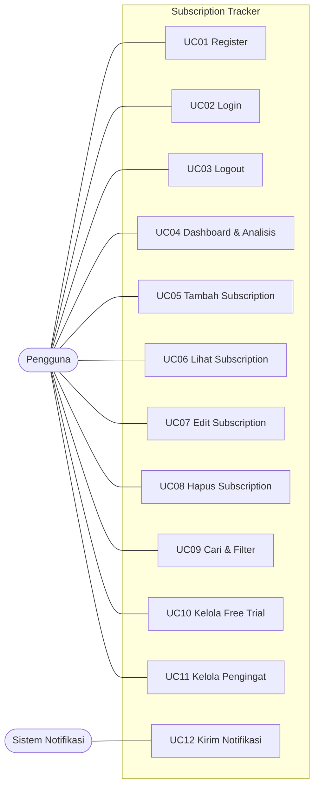

# PRODUCT REQUIREMENTS DOCUMENT (PRD)

**Mata Kuliah:** Software Engineering | **Dosen Pengampu:** Christian, S.Kom., M.MT.  
**Program Studi:** Informatika, Universitas Ciputra Surabaya (2026)  
**Aplikasi:** Subscription Tracker (Team 5)  
**Anggota Kelompok:** Arya Pramudika (1076012614909), Dessica Suhaedi Hartono (0706012324017), Diardo Marendi Krista (070612424024), Gita Iriana (070612424021), Muhammad Hafiz Adra (070612414007)

---

### 1. Ringkasan Produk

*Subscription Tracker* adalah aplikasi web untuk mencatat seluruh langganan digital pengguna di satu tempat, memantau jadwal pembayaran, mengirim pengingat sebelum tanggal tagihan atau berakhirnya *free trial*, dan menghitung estimasi pengeluaran bulanan serta tahunan.

Aplikasi berfungsi sebagai media **pencatatan, pemantauan, dan pengingat**. Aplikasi tidak terhubung ke rekening bank, kartu kredit/debit, *payment gateway*, maupun sistem penyedia layanan. Pembatalan atau perpanjangan langganan tetap dilakukan pengguna melalui platform penyedia masing-masing.

### 2. Latar Belakang

Layanan berbasis langganan kini dipakai untuk hiburan, produktivitas, penyimpanan cloud, hingga pendidikan, dan telah menjadi bagian dari ekonomi digital di Indonesia (Kembau et al., 2025). Pengguna yang berlangganan di banyak platform menghadapi jadwal penagihan, periode, dan biaya yang berbeda pada setiap layanan.

Pengguna cenderung mempertahankan langganan karena *commitment bias* dan *switching cost*, sehingga langganan jarang ditinjau ulang (Kembau et al., 2025). Mekanisme *auto-renewal* memperbesar masalah, terutama pada transparansi informasi dan proses penghentian layanan (Haura et al., 2026). Pengguna yang lupa membatalkan langganan akan tetap ditagih untuk layanan yang tidak lagi dibutuhkan.

### 3. Rumusan Masalah

| No | Masalah | Dampak bagi pengguna |
|----|---------|----------------------|
| 1 | Sulit melacak langganan aktif | Pengguna lupa layanan apa saja yang dilanggan, terlebih bila metode pembayarannya berbeda-beda. |
| 2 | Risiko autodebit yang tidak diinginkan | Tanpa pengingat, pengguna tertagih untuk layanan yang sebenarnya ingin dihentikan. |
| 3 | Lupa membatalkan *free trial* | Masa uji coba berakhir tanpa disadari dan pengguna dikenakan biaya. |
| 4 | Kurangnya visibilitas total pengeluaran | Pembayaran yang tersebar membuat pengguna tidak tahu total biaya bulanan atau tahunan. |

### 4. Tujuan Produk

1. Memusatkan pencatatan seluruh langganan pengguna.
2. Mengirim pengingat otomatis sebelum jatuh tempo pembayaran dan akhir *free trial*.
3. Menyajikan estimasi pengeluaran bulanan dan tahunan pada dashboard.

### 5. Stakeholder

| Stakeholder | Jenis | Tujuan | Kendala | Solusi dari perangkat lunak |
|-------------|-------|--------|---------|------------------------------|
| Pengguna Aplikasi (*End User*) | User | Mengelola seluruh langganan di satu tempat dan terhindar dari biaya tak terduga. | Langganan tersebar di banyak platform; tidak ada pengingat sebelum penagihan; lupa membatalkan *free trial*; tidak mengetahui total pengeluaran. | Pencatatan terpusat, pengingat sebelum jatuh tempo dan akhir *free trial*, ringkasan total pengeluaran otomatis. |
| Pengembang Aplikasi (*Developer*) | Non-User | Membangun sistem yang stabil, mudah dipelihara, dan memenuhi kebutuhan fungsional maupun non-fungsional. | Harus merancang pengingat yang akurat dan menyimpan data langganan dengan aman. | Struktur data yang jelas, notifikasi terjadwal, dan penyimpanan tanpa data kartu pembayaran. |

### 6. Ruang Lingkup

**Termasuk dalam lingkup:**
- Autentikasi: register, login, logout.
- Pengelolaan langganan (tambah, lihat, ubah, hapus): nama layanan, kategori, biaya, periode pembayaran, tanggal pembayaran berikutnya, dan metode pembayaran.
- Pencatatan masa *free trial* beserta tanggal berakhirnya.
- Informasi langganan yang mendekati tanggal pembayaran serta pengingat sebelum tanggal pembayaran atau akhir *free trial*.
- Estimasi total pengeluaran bulanan dan tahunan.
- Kategori kustom dan alias metode pembayaran per pengguna.
- Riwayat notifikasi dan log aktivitas (*audit trail*).

**Di luar lingkup:**
- Integrasi dengan bank, kartu, *payment gateway*, atau penyedia layanan.
- Pembatalan atau perpanjangan langganan secara otomatis.
- Penyimpanan nomor kartu, CVV, PIN, atau data rekening.
- Konversi multi-mata uang (mata uang default: IDR).

### 7. Use Case

Aktor: **Pengguna** dan **Sistem Notifikasi**.

| ID | Use case | Aktor | Deskripsi ringkas |
|----|----------|-------|-------------------|
| UC01 | Register | Pengguna | Membuat akun baru dengan data yang diperlukan. |
| UC02 | Login | Pengguna | Masuk ke sistem dengan akun terdaftar. |
| UC03 | Logout | Pengguna | Keluar dari sistem dan mengakhiri sesi. |
| UC04 | Lihat Dashboard & Analisis Pengeluaran | Pengguna | Melihat ringkasan langganan aktif, tagihan terdekat, dan estimasi pengeluaran bulanan serta tahunan. |
| UC05 | Tambah Subscription | Pengguna | Menambahkan layanan beserta biaya, kategori, metode pembayaran, dan tanggal pembayaran. |
| UC06 | Lihat Subscription | Pengguna | Melihat daftar dan detail langganan tersimpan. |
| UC07 | Edit Subscription | Pengguna | Memperbarui informasi langganan. |
| UC08 | Hapus Subscription | Pengguna | Menghapus langganan yang tidak lagi diperlukan. |
| UC09 | Cari & Filter Subscription | Pengguna | Mencari dan memfilter langganan berdasarkan nama, kategori, status, atau metode pembayaran. |
| UC10 | Kelola Free Trial | Pengguna | Mencatat masa *free trial* dan tanggal berakhirnya. |
| UC11 | Kelola Pengingat Jatuh Tempo | Pengguna | Mengaktifkan atau mengatur pengingat sebelum tanggal pembayaran atau akhir *free trial*. |
| UC12 | Kirim Notifikasi Jatuh Tempo | Sistem Notifikasi | Mengirim notifikasi kepada pengguna sebelum tanggal pembayaran atau akhir *free trial*. |

### 8. Kebutuhan Fungsional

| ID | Deskripsi | Prioritas | Use case |
|----|-----------|-----------|----------|
| FR-001 | Sistem memungkinkan pengguna melakukan pendaftaran, login, dan logout. | High | UC01–UC03 |
| FR-002 | Sistem menyediakan manajemen data langganan (tambah, lihat, ubah, hapus) beserta detail nama, biaya, periode, dan tanggal. | High | UC05–UC08 |
| FR-003 | Sistem memungkinkan pencarian dan pemfilteran langganan berdasarkan nama, kategori, status, atau metode pembayaran. | Medium | UC09 |
| FR-004 | Sistem memungkinkan pencatatan dan penayangan masa *free trial* beserta tanggal berakhirnya. | High | UC10 |
| FR-005 | Sistem menampilkan dashboard ringkasan langganan, *upcoming payment*, dan estimasi pengeluaran bulanan serta tahunan. | High | UC04 |
| FR-006 | Sistem memberikan pengingat atau notifikasi otomatis sebelum tanggal pembayaran atau akhir *free trial*. | High | UC11, UC12 |

### 9. Kebutuhan Non-Fungsional

| ID | Parameter kualitas | Target terukur |
|----|--------------------|----------------|
| NFR-001 | Performance | Waktu muat dashboard utama tidak melebihi 1,5 detik pada jaringan normal. |
| NFR-002 | Usability | Antarmuka responsif (desktop dan mobile) dan memenuhi kontras warna WCAG 2.1 AA. |
| NFR-003 | Reliability | Scheduler pengingat berjalan konsisten dengan keterlambatan maksimal 15 menit dari jadwal. |
| NFR-004 | Security & Privacy | Kata sandi di-hash dengan bcrypt; sistem terlindung dari XSS dan SQL Injection. |
| NFR-005 | Hardware / Environment | Backend berjalan pada server 1 GB RAM, 1 vCPU, 10 GB storage, dan diakses lewat peramban modern. |

### 10. Kriteria Keberhasilan

- Seluruh FR-001 sampai FR-006 dan UC01 sampai UC12 terimplementasi dan lulus kasus uji (TC-01 sampai TC-24; lihat [SESI_15_TEST_PLAN.md](SESI_15_TEST_PLAN.md)).
- Pengguna dapat melihat total estimasi pengeluaran bulanan dan tahunan tanpa menghitung manual.
- Pengingat terkirim tepat satu kali untuk setiap jadwal, tanpa notifikasi berulang.

### 11. Keterbatasan yang Diketahui dan Rencana Pengembangan

| Keterbatasan | Rencana pengembangan |
|--------------|----------------------|
| NFR-001 dan NFR-005 belum diukur dengan uji performa tersendiri. | Uji performa dashboard dan uji beban scheduler. |
| Kontras warna WCAG 2.1 AA (NFR-002) belum diaudit dengan alat pemeriksa. | Audit aksesibilitas otomatis pada setiap halaman. |
| Kanal notifikasi terbatas pada email dan notifikasi di dalam aplikasi. | Push notification atau aplikasi pesan. |
| Hanya mendukung satu mata uang (IDR) dalam kalkulasi. | Dukungan multi-mata uang dengan konversi ke IDR. |

---

**Dokumen terkait:** [DESAIN_SISTEM.md](DESAIN_SISTEM.md) · [RANCANGAN_TEKNIS.md](RANCANGAN_TEKNIS.md) · [SESI_14_CODING_STANDARD.md](SESI_14_CODING_STANDARD.md) · [SESI_15_TEST_PLAN.md](SESI_15_TEST_PLAN.md)
