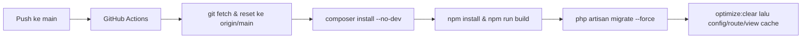

# DOKUMEN RANCANGAN TEKNIS (TECHNICAL DESIGN)

**Mata Kuliah:** Software Engineering | **Dosen Pengampu:** Christian, S.Kom., M.MT.  
**Program Studi:** Informatika, Universitas Ciputra Surabaya (2026)  
**Aplikasi:** Subscription Tracker (Team 5)  
**Anggota Kelompok:** Arya Pramudika (1076012614909), Dessica Suhaedi Hartono (0706012324017), Diardo Marendi Krista (070612424024), Gita Iriana (070612424021), Muhammad Hafiz Adra (070612414007)

---

### 1. Pendahuluan

Dokumen ini menjelaskan cara desain pada [DESAIN_SISTEM.md](DESAIN_SISTEM.md) diwujudkan dalam kode: teknologi yang dipakai, struktur folder, skema basis data, rute, mekanisme scheduler dan notifikasi, keamanan, serta deployment. Panduan instalasi lokal ada di [README.md](../README.md).

### 2. Teknologi yang Digunakan

| Lapisan | Teknologi |
|---------|-----------|
| Bahasa dan framework | PHP 8.3+ dengan Laravel 13; Backed Enums untuk status dan periode |
| Presentasi | Laravel Blade dan Tailwind CSS (responsif desktop dan mobile) |
| Akses data | Eloquent ORM dengan pola repository |
| Basis data | MySQL atau MariaDB; SQLite in-memory untuk pengujian |
| Penjadwalan dan email | Laravel Scheduler (`routes/console.php`) dan Laravel Mailer (SMTP) |
| Pengujian | PHPUnit melalui `php artisan test` |
| Pengelola dependensi | Composer 2.x, npm (build aset Vite) |
| CI/CD | GitHub Actions dengan *self-hosted runner* Windows (Laragon) |

### 3. Struktur Kode per Lapisan

Struktur folder mengikuti arsitektur berlapis pada desain sistem.

| Lapisan | Lokasi | Isi |
|---------|--------|-----|
| Presentation | `resources/views/` | View Blade per modul; layout utama di `layouts/app.blade.php` |
| Routing | `routes/web.php`, `routes/console.php` | Rute web dan jadwal scheduler |
| Validasi | `app/Http/Requests/` | `RegisterRequest`, `LoginRequest`, `Store/UpdateSubscriptionRequest`, `StoreReminderRequest`, `Store/UpdateCategoryRequest`, `Store/UpdatePaymentMethodRequest` |
| Controller | `app/Http/Controllers/` | Auth, Dashboard, Subscription, Category, PaymentMethod, Reminder, Notification, ActivityLog |
| Service | `app/Services/` | `AuthService`, `DashboardService`, `SubscriptionService`, `CategoryService`, `PaymentMethodService`, `ReminderService`, `NotificationService` |
| Repository | `app/Repositories/` | `SubscriptionRepository`, `CategoryRepository`, `PaymentMethodRepository`, `ReminderRepository`, `NotificationRepository`, `ActivityLogRepository` |
| Domain | `app/Models/`, `app/Enums/` | Delapan model Eloquent dan lima Backed Enum |
| Background job | `app/Console/Commands/CheckRemindersCommand.php` | Perintah `app:check-reminders` |
| Email | `app/Mail/SubscriptionReminderMail.php` | Template email pengingat |
| Skema data | `database/migrations/`, `database/seeders/` | Migration delapan tabel dan data awal |

Aturan antarlapisan: controller tidak berisi query mentah atau logika bisnis; seluruh aturan bisnis berada di service; hanya repository dan model yang menyentuh basis data. Detail konvensi ada di [SESI_14_CODING_STANDARD.md](SESI_14_CODING_STANDARD.md).

### 4. Rancangan Basis Data

#### 4.1 Daftar Tabel dan Kolom

**`users`**

| Kolom | Tipe | Keterangan |
|-------|------|------------|
| id | BIGINT UNSIGNED | PK |
| name | VARCHAR(100) | |
| email | VARCHAR(100) | UNIQUE |
| password | VARCHAR(255) | Hash bcrypt |
| remember_token | VARCHAR(100) | Nullable |
| created_at, updated_at | TIMESTAMP | |

**`categories`**

| Kolom | Tipe | Keterangan |
|-------|------|------------|
| id | BIGINT UNSIGNED | PK |
| user_id | BIGINT UNSIGNED | FK → users, nullable (NULL = kategori bawaan sistem), CASCADE |
| name | VARCHAR(100) | UNIQUE (user_id, name) |
| icon | VARCHAR(50) | Nullable |
| color | VARCHAR(7) | Kode warna hex, nullable |

**`payment_methods`**

| Kolom | Tipe | Keterangan |
|-------|------|------------|
| id | BIGINT UNSIGNED | PK |
| user_id | BIGINT UNSIGNED | FK → users, CASCADE |
| name | VARCHAR(100) | Label alias saja, misalnya "BCA Debit"; UNIQUE (user_id, name) |

**`subscriptions`**

| Kolom | Tipe | Keterangan |
|-------|------|------------|
| id | BIGINT UNSIGNED | PK |
| user_id | BIGINT UNSIGNED | FK → users, CASCADE |
| category_id | BIGINT UNSIGNED | FK → categories, nullable, SET NULL |
| payment_method_id | BIGINT UNSIGNED | FK → payment_methods, nullable, SET NULL |
| name | VARCHAR(100) | Nama layanan |
| price | DECIMAL(10,2) | |
| currency | VARCHAR(10) | Default `IDR` |
| billing_period | VARCHAR(20) | `BillingPeriod` |
| billing_day | TINYINT UNSIGNED | Tanggal tagihan asli (1–31), nullable |
| next_payment_date | DATE | |
| status | VARCHAR(20) | `SubscriptionStatus`, default `ACTIVE` |
| is_free_trial | BOOLEAN | Default false |

**`free_trials`**

| Kolom | Tipe | Keterangan |
|-------|------|------------|
| id | BIGINT UNSIGNED | PK |
| subscription_id | BIGINT UNSIGNED | FK → subscriptions, UNIQUE (relasi 1 : 0..1), CASCADE |
| start_date, end_date | DATE | |
| cancel_before_days | INT | Default 1 |
| is_converted | BOOLEAN | Default false; true setelah TRIAL → ACTIVE |

**`reminders`**

| Kolom | Tipe | Keterangan |
|-------|------|------------|
| id | BIGINT UNSIGNED | PK |
| user_id | BIGINT UNSIGNED | FK → users, CASCADE |
| subscription_id | BIGINT UNSIGNED | FK → subscriptions, CASCADE |
| type | VARCHAR(20) | `ReminderType` |
| notify_before_days | INT | H-n, default 3 |
| is_active | BOOLEAN | Default true |

**`notifications`**

| Kolom | Tipe | Keterangan |
|-------|------|------------|
| id | BIGINT UNSIGNED | PK |
| user_id | BIGINT UNSIGNED | FK → users, CASCADE |
| reminder_id | BIGINT UNSIGNED | FK → reminders, nullable, SET NULL |
| title | VARCHAR(150) | |
| message | TEXT | |
| type | VARCHAR(30) | `NotificationType` |
| status | VARCHAR(20) | `NotificationStatus`, default `PENDING` |
| sent_at, read_at | TIMESTAMP | Nullable |

**`activity_logs`**

| Kolom | Tipe | Keterangan |
|-------|------|------------|
| id | BIGINT UNSIGNED | PK |
| user_id | BIGINT UNSIGNED | FK → users, CASCADE |
| action | VARCHAR(50) | LOGIN, LOGOUT, CREATE, UPDATE, DELETE, CANCEL |
| entity | VARCHAR(50) | Subscription, FreeTrial, Reminder, dan lainnya |
| entity_id | BIGINT UNSIGNED | Nullable |
| description | TEXT | Nullable |
| created_at | TIMESTAMP | Default waktu saat ini |

Tabel `cache`, `jobs`, dan `sessions` bawaan Laravel juga dibuat oleh migration standar framework.

#### 4.2 Strategi Pengindeksan

Setiap indeks melayani pola query yang sering dijalankan, terutama oleh dashboard dan scheduler.

| Tabel | Indeks | Tujuan |
|-------|--------|--------|
| users | UNIQUE (email) | Login cepat dan mencegah akun ganda |
| categories | UNIQUE (user_id, name) | Mencegah nama kategori ganda per pengguna |
| payment_methods | UNIQUE (user_id, name) | Mencegah label ganda per pengguna |
| subscriptions | (user_id, status) | Menampilkan langganan aktif milik pengguna |
| subscriptions | (next_payment_date) | Mencari tagihan jatuh tempo oleh scheduler |
| free_trials | UNIQUE (subscription_id) | Menjamin relasi 1 : 0..1 |
| reminders | (is_active, subscription_id) | Memilih pengingat aktif untuk diproses |
| notifications | (user_id, status) | Menghitung dan menampilkan notifikasi belum dibaca |
| activity_logs | (user_id, created_at) | Riwayat aktivitas per pengguna menurut waktu |
| activity_logs | (entity, entity_id) | Melacak riwayat satu entitas tertentu |

#### 4.3 Data Awal (Seeder)

`php artisan migrate:fresh --seed` membuat akun demo (`user@example.com` / `password`), lima kategori bawaan (Hiburan & Streaming, Produktivitas & Kerja, Penyimpanan Cloud, Pendidikan & Kursus, Utilitas & Tools), dan contoh metode pembayaran. Setiap akun baru mendapat salinan kategori bawaan sehingga pengguna dapat mengubahnya tanpa memengaruhi akun lain.

### 5. Rute Aplikasi

Seluruh rute selain login dan register dilindungi middleware `auth`.

| Metode | URI | Controller@aksi | Use case |
|--------|-----|-----------------|----------|
| GET/POST | `/register` | `AuthController@showRegisterForm` / `register` | UC01 |
| GET/POST | `/login` | `AuthController@showLoginForm` / `login` | UC02 |
| POST | `/logout` | `AuthController@logout` | UC03 |
| GET | `/dashboard` | `DashboardController@index` | UC04 |
| Resource | `/subscriptions` | `SubscriptionController` (index, create, store, show, edit, update, destroy) | UC05–UC10 |
| Resource | `/categories` | `CategoryController` | FR-002, FR-003 |
| Resource | `/payment-methods` | `PaymentMethodController` | FR-002, FR-003 |
| GET/POST | `/reminders` | `ReminderController@index` / `store` | UC11 |
| PATCH | `/reminders/{reminder}/toggle` | `ReminderController@toggle` | UC11 |
| DELETE | `/reminders/{reminder}` | `ReminderController@destroy` | UC11 |
| GET | `/notifications` | `NotificationController@index` | UC12 |
| PATCH | `/notifications/{notification}/read` | `NotificationController@markAsRead` | UC12 |
| GET | `/activity-logs` | `ActivityLogController@index` | NFR-004 |

### 6. Logika Bisnis Utama

#### 6.1 Normalisasi Biaya (Dashboard)

`BillingPeriod` menyediakan `toMonthlyCost()` dan `toYearlyCost()` untuk menormalkan harga ke basis bulanan atau tahunan. `DashboardService` menjumlahkan hasil normalisasi seluruh langganan aktif. Contoh: Rp100.000 bulanan dan Rp1.200.000 tahunan menghasilkan estimasi Rp200.000 per bulan (TC-08). Dashboard juga menampilkan tagihan dalam 7 hari ke depan melalui `getUpcomingPayments()`.

#### 6.2 Tanggal Tagihan Berikutnya

`BillingPeriod::nextDateAfter()` menghitung tanggal tagihan berikutnya dengan memperhitungkan `billing_day`. Kolom ini menyimpan tanggal tagihan asli agar langganan tanggal 31 menjadi 28 Februari lalu kembali ke 31 Maret, bukan terkunci di tanggal 28 (TC-21). Tanggal tagihan yang sudah lewat dimajukan otomatis oleh `SubscriptionService::rollForwardPastDuePayments()` setiap kali scheduler berjalan.

#### 6.3 Transaksi Langganan dan Free Trial

`SubscriptionService` membungkus penyimpanan langganan dan *free trial* dalam `DB::transaction` agar kedua tabel tersimpan bersama atau tidak sama sekali. Perubahan status dari `TRIAL` ke `ACTIVE` menandai `is_converted = true` dan dicatat di log aktivitas (TC-24).

#### 6.4 Scheduler dan Notifikasi

```text
routes/console.php  →  Schedule::command('app:check-reminders')->everyMinute()
```

Setiap kali berjalan, `CheckRemindersCommand`:

1. Memajukan tanggal tagihan yang sudah lewat ke siklus berikutnya.
2. Memanggil `NotificationService::checkDueReminders()` yang mengambil seluruh pengingat aktif.
3. Untuk setiap pengingat, `Reminder::isDue()` memeriksa bahwa langganan berstatus `ACTIVE` atau `TRIAL` dan tanggal hari ini sudah mencapai `getTriggerDate()` (tanggal tagihan atau akhir *free trial* dikurangi `notify_before_days`).
4. Bila belum ada notifikasi untuk pengingat itu sejak *trigger date*, sistem membuat `Notification` berstatus `PENDING`, mengirim `SubscriptionReminderMail`, lalu mengubah status menjadi `SENT` atau `FAILED`.

Pemeriksaan *trigger date* pada langkah 4 mencegah email terkirim berulang pada H-3, H-2, dan H-1 (TC-15), sekaligus memungkinkan pengiriman susulan bila scheduler sempat mati (TC-16). Penjadwalan setiap menit memenuhi batas keterlambatan 15 menit pada NFR-003.

Validasi `StoreReminderRequest` menolak jumlah hari pengingat yang melebihi panjang siklus tagihan (misalnya H-3 pada langganan harian, TC-17) dan pengingat kembar dengan langganan, jenis, dan H-n yang sama (TC-22).

### 7. Keamanan

| Aspek | Penerapan | Kebutuhan |
|-------|-----------|-----------|
| Kata sandi | Di-hash dengan bcrypt sebelum disimpan | NFR-004 |
| Data pembayaran | Hanya alias; tidak ada nomor kartu, CVV, PIN, atau rekening | NFR-004 |
| Isolasi data | Service memeriksa kepemilikan (`ensureOwnership`) sebelum membaca atau mengubah data; akses data milik pengguna lain ditolak dengan HTTP 403 | FR-001, NFR-004 |
| SQL Injection | Seluruh query melalui Eloquent / query terparametrisasi | NFR-004 |
| XSS | Output Blade memakai *auto-escaping* `{{ }}` | NFR-004 |
| Audit trail | Aksi LOGIN, LOGOUT, CREATE, UPDATE, DELETE dicatat di `activity_logs` | NFR-004 |

### 8. Konfigurasi Lingkungan

Variabel penting pada `.env`:

| Variabel | Fungsi |
|----------|--------|
| `DB_CONNECTION`, `DB_DATABASE`, `DB_USERNAME`, `DB_PASSWORD` | Koneksi MySQL/MariaDB (`subscription_tracker`) |
| `MAIL_MAILER`, `MAIL_HOST`, `MAIL_PORT`, `MAIL_USERNAME`, `MAIL_PASSWORD` | Pengiriman email pengingat; `MAIL_MAILER=log` menulis email ke `storage/logs/laravel.log` saat pengembangan |
| `APP_KEY` | Kunci enkripsi aplikasi (`php artisan key:generate`) |

Perintah operasional:

```bash
php artisan test                 # menjalankan seluruh pengujian otomatis
php artisan app:check-reminders  # memeriksa pengingat jatuh tempo seketika
php artisan schedule:work        # menjalankan scheduler berkala secara lokal
```

### 9. Deployment

Aplikasi diterbitkan di **subscriptiontracker.diardo.my.id**. Workflow `.github/workflows/deploy.yml` berjalan setiap ada push ke branch `main` (atau dipicu manual) pada *self-hosted runner* Windows dengan Laragon:



Di server, penjadwal sistem operasi (cron di Linux atau Task Scheduler di Windows) memanggil `php artisan schedule:run` setiap menit; caranya dijelaskan di README bagian 08.

### 10. Penyesuaian dari Desain ke Implementasi

| Penyesuaian | Alasan |
|-------------|--------|
| `BillingPeriod` mendapat nilai `QUARTERLY` | Banyak layanan menagih per tiga bulan; kalkulasi pengeluaran harus menormalkannya. |
| `SubscriptionService` ditambahkan di samping `DashboardService` dan `NotificationService` | Logika CRUD, filter, dan transaksi *free trial* butuh tempat di service layer. |
| Penyimpanan langganan dan *free trial* dibungkus `DB::transaction` | Kedua tabel harus tersimpan bersama atau tidak sama sekali. |
| Kolom `billing_day` pada `subscriptions` | Menjaga tanggal tagihan asli setelah melewati bulan pendek (TC-21). |
| Pemeriksaan *trigger date* pada `NotificationService` | Mencegah email berulang pada H-3, H-2, dan H-1 (TC-15). |
| Validasi dinamis jumlah hari pengingat terhadap periode tagihan | Pengingat H-3 tidak masuk akal untuk langganan harian (TC-17). |
| Kategori bawaan disalin ke setiap akun | Pengguna dapat mengubah kategori tanpa memengaruhi akun lain. |

---

**Dokumen terkait:** [PRD.md](PRD.md) · [DESAIN_SISTEM.md](DESAIN_SISTEM.md) · [SESI_14_CODING_STANDARD.md](SESI_14_CODING_STANDARD.md) · [SESI_15_TEST_PLAN.md](SESI_15_TEST_PLAN.md)
